# DCS Attendance System — Updated ERD

This ERD reflects the active **DCS Attendance System** database design. It separates the two attendance flows:

- **School IN/OUT → DTR:** `entrance_attendances`
- **Class attendance → reports and analytics:** `attendance_logs`

`payroll_periods` and `payroll_records` are retained only for legacy-data compatibility. They are not part of the active application flow.

```mermaid
erDiagram
    USERS {
        bigint id PK
        bigint employee_id FK "nullable; faculty account link"
        string name
        string email UK
        string role "admin | faculty | guard"
        boolean must_change_password
        timestamp email_verified_at
        integer security_version
    }

    EMPLOYEES {
        bigint id PK
        bigint faculty_rank_id FK "nullable"
        string employee_no UK
        string email UK
        string first_name
        string last_name
        string status "active | inactive"
        timestamp archived_at "nullable"
    }

    FACULTY_RANKS {
        bigint id PK
        string name UK
        boolean is_active
    }

    RFID_CARDS {
        bigint id PK
        bigint employee_id FK
        string rfid_uid UK
        string status
    }

    FINGERPRINT_TEMPLATES {
        bigint id PK
        bigint employee_id FK
        string fingerprint_code UK
        string status
    }

    HARDWARE_ENROLLMENTS {
        bigint id PK
        bigint employee_id FK
        string method
        string operation
        string status
        bigint requested_by FK "nullable"
    }

    HARDWARE_ATTENDANCE_EVENTS {
        bigint id PK
        bigint employee_id FK
        string event_id UK
        string method
        datetime occurred_at
    }

    ACADEMIC_TERMS {
        bigint id PK
        string school_year
        string semester
        date start_date
        date end_date
        string status "draft | active | closed"
    }

    FACULTY_TERM_ASSIGNMENTS {
        bigint id PK
        bigint academic_term_id FK
        bigint employee_id FK
        json profile
        json draft_blocks
    }

    FACULTY_SCHEDULE_VERSIONS {
        bigint id PK
        bigint academic_term_id FK
        bigint employee_id FK
        bigint published_by FK "nullable"
        date effective_from
        json profile
    }

    FACULTY_SCHEDULES {
        bigint id PK
        bigint employee_id FK
        bigint academic_term_id FK "nullable for legacy"
        bigint schedule_version_id FK "nullable for legacy"
        string subject
        string section
        string class_mode
        string schedule_type "class | consultation"
        integer day_of_week
        time start_time
        time end_time
    }

    FACULTY_SCHEDULE_BREAKS {
        bigint id PK
        bigint employee_id FK
        bigint academic_term_id FK "nullable for legacy"
        bigint schedule_version_id FK "nullable for legacy"
        string schedule_type
        integer day_of_week
        time start_time
        time end_time
    }

    SEMESTER_DAY_SNAPSHOTS {
        bigint id PK
        bigint academic_term_id FK
        bigint employee_id FK
        date date
        json payload
    }

    SEMESTER_EVENTS {
        bigint id PK
        bigint academic_term_id FK
        bigint employee_id FK "nullable"
        bigint actor_id FK "nullable"
        string action
        json before
        json after
    }

    ENTRANCE_ATTENDANCES {
        bigint id PK
        bigint employee_id FK
        bigint academic_term_id FK "nullable"
        bigint recorded_by FK "nullable"
        bigint out_recorded_by FK "nullable"
        date attendance_date
        time time_in
        time time_out "nullable"
        string source
        json schedule_snapshot
    }

    ATTENDANCE_LOGS {
        bigint id PK
        bigint employee_id FK
        bigint academic_term_id FK "nullable"
        bigint faculty_schedule_id FK "nullable"
        date attendance_date
        time time_in
        time time_out
        string method_in
        string method_out
        string subject
        string section
        string class_mode
        string schedule_type
        integer late_minutes
        integer undertime_minutes
        integer worked_seconds
        string status
    }

    CALENDAR_EVENTS {
        bigint id PK
        bigint created_by FK "nullable"
        string title
        string type
        date start_date
        date end_date
        string scope_type
    }

    CALENDAR_EVENT_EMPLOYEE {
        bigint id PK
        bigint calendar_event_id FK
        bigint employee_id FK
    }

    LEAVE_TYPES {
        bigint id PK
        string code UK
        string name
        boolean is_paid
        boolean is_active
    }

    LEAVE_REQUESTS {
        bigint id PK
        bigint employee_id FK
        bigint leave_type_id FK
        bigint reviewed_by FK "nullable"
        date start_date
        date end_date
        string status
    }

    DTR_SIGNATORIES {
        bigint id PK
        bigint created_by FK "nullable"
        string name
        string designation
        date effective_from
        date effective_to
    }

    SYSTEM_SETTINGS {
        bigint id PK
        string key UK
        text value
    }

    AUDIT_TRAILS {
        bigint id PK
        string action
        string table_name
        bigint record_id
        text description
    }

    EMPLOYEES o|--o| USERS : "has faculty account"
    FACULTY_RANKS o|--o{ EMPLOYEES : "assigned rank"
    EMPLOYEES ||--o{ RFID_CARDS : "has"
    EMPLOYEES ||--o{ FINGERPRINT_TEMPLATES : "has"
    EMPLOYEES ||--o{ HARDWARE_ENROLLMENTS : "credential request"
    USERS o|--o{ HARDWARE_ENROLLMENTS : "requested"
    EMPLOYEES ||--o{ HARDWARE_ATTENDANCE_EVENTS : "hardware event"

    ACADEMIC_TERMS ||--o{ FACULTY_TERM_ASSIGNMENTS : "faculty assignment"
    EMPLOYEES ||--o{ FACULTY_TERM_ASSIGNMENTS : "assigned in term"
    ACADEMIC_TERMS ||--o{ FACULTY_SCHEDULE_VERSIONS : "schedule history"
    EMPLOYEES ||--o{ FACULTY_SCHEDULE_VERSIONS : "owns versions"
    USERS o|--o{ FACULTY_SCHEDULE_VERSIONS : "published"
    ACADEMIC_TERMS o|--o{ FACULTY_SCHEDULES : "term schedule"
    FACULTY_SCHEDULE_VERSIONS o|--o{ FACULTY_SCHEDULES : "publishes blocks"
    EMPLOYEES ||--o{ FACULTY_SCHEDULES : "teaches"
    ACADEMIC_TERMS o|--o{ FACULTY_SCHEDULE_BREAKS : "term break"
    FACULTY_SCHEDULE_VERSIONS o|--o{ FACULTY_SCHEDULE_BREAKS : "publishes blocks"
    EMPLOYEES ||--o{ FACULTY_SCHEDULE_BREAKS : "has"
    ACADEMIC_TERMS ||--o{ SEMESTER_DAY_SNAPSHOTS : "daily basis"
    EMPLOYEES ||--o{ SEMESTER_DAY_SNAPSHOTS : "snapshot"
    ACADEMIC_TERMS ||--o{ SEMESTER_EVENTS : "history"
    EMPLOYEES o|--o{ SEMESTER_EVENTS : "affected faculty"
    USERS o|--o{ SEMESTER_EVENTS : "actor"

    EMPLOYEES ||--o{ ENTRANCE_ATTENDANCES : "school IN/OUT"
    ACADEMIC_TERMS o|--o{ ENTRANCE_ATTENDANCES : "belongs to"
    USERS o|--o{ ENTRANCE_ATTENDANCES : "records IN/OUT"
    EMPLOYEES ||--o{ ATTENDANCE_LOGS : "class session"
    ACADEMIC_TERMS o|--o{ ATTENDANCE_LOGS : "belongs to"
    FACULTY_SCHEDULES o|--o{ ATTENDANCE_LOGS : "scheduled session"

    USERS o|--o{ CALENDAR_EVENTS : "created"
    CALENDAR_EVENTS ||--o{ CALENDAR_EVENT_EMPLOYEE : "targets"
    EMPLOYEES ||--o{ CALENDAR_EVENT_EMPLOYEE : "covered faculty"
    EMPLOYEES ||--o{ LEAVE_REQUESTS : "files"
    LEAVE_TYPES ||--o{ LEAVE_REQUESTS : "classifies"
    USERS o|--o{ LEAVE_REQUESTS : "reviews"
    USERS o|--o{ DTR_SIGNATORIES : "created"
```

## Attendance and DTR basis

| Output | Source of truth | Important rule |
|---|---|---|
| School attendance | `entrance_attendances` | One IN/OUT pair per faculty per day. |
| Daily Time Record | `entrance_attendances.schedule_snapshot` plus the applicable schedule/day snapshot | Class hardware logs never update DTR hours. |
| Class monitoring and analytics | `attendance_logs` plus historical schedule/session data | Only class sessions are eligible; consultation is excluded from class analytics. |
| Late, undertime, absent, for-review states | Derived from the schedule/session basis and `attendance_logs` | These are not separate status tables. |

## Historical-data notes

- `academic_terms`, schedule versions, and day snapshots preserve the schedule basis even after a new semester begins.
- `academic_term_id` is nullable on attendance/schedule tables only to support legacy records that have not been mapped to a verified semester.
- Closed terms remain visible for history but should not accept normal schedule changes.
- `payroll_periods` and `payroll_records` remain in the database for migration/backup compatibility only and are intentionally omitted from the active ERD.
